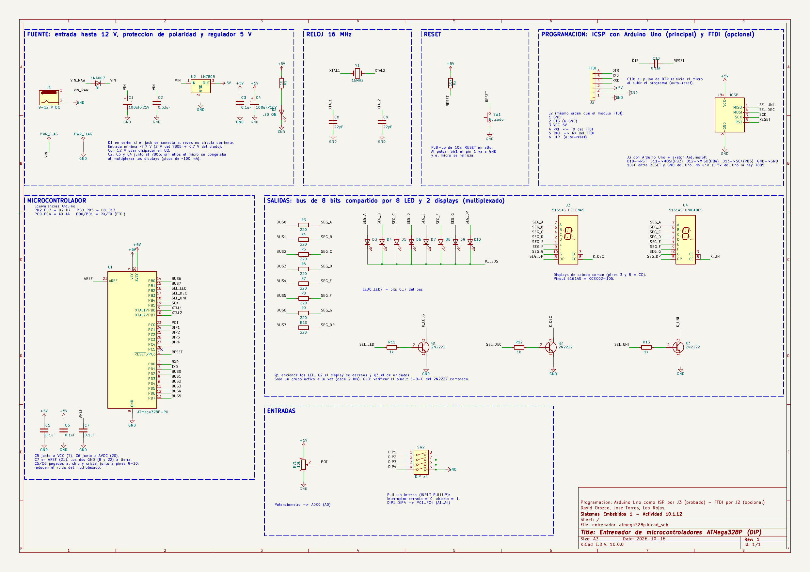
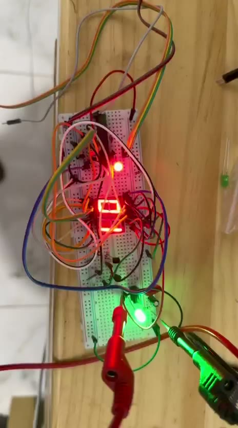
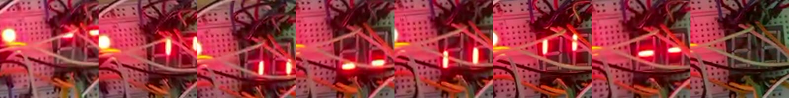
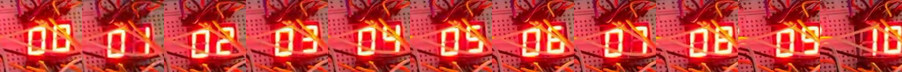
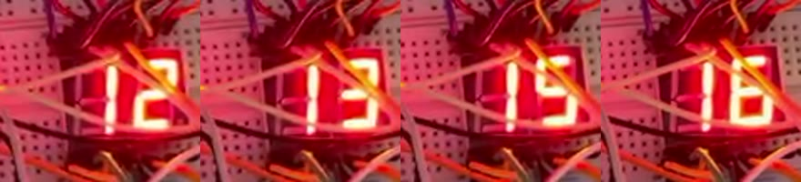

# C2 — Entrenador de microcontroladores con ATMega328P (DIP)

**Sistemas Embebidos 1 — Actividad 10.1.12** (sección *10.1. Microcontrolador ATmega328* del material)

**Integrantes:** David Orozco, Jose Torres, Leo Rojas

## Estado del avance (16 de octubre de 2026)

| Parte | Estado |
|-------|--------|
| Diseño y asignación de pines | Terminado |
| Esquemático en KiCad (ERC sin errores) | Terminado — [`kicad/esquematico.pdf`](kicad/esquematico.pdf) |
| Lista de conexiones pin a pin | Terminado — [`kicad/CONEXIONES.md`](kicad/CONEXIONES.md) |
| ATMega328P en protoboard con cristal de 16 MHz y LM7805 | Funcionando |
| Programación con Arduino Uno como ISP (bootloader + fusibles) | Funcionando |
| 2 displays de 7 segmentos multiplexados con 2 transistores | Funcionando (ver problema 4) |
| 8 LED + Q1, potenciómetro, DIP switch | Pendiente de montar |
| Firmware completo del entrenador (`firmware/entrenador`) | Compila; falta probarlo en hardware |
| Simulación en SimulIDE | Pendiente |
| PCB universal | Pendiente |

## 1. Requisitos del enunciado

| # | Requisito | Cómo se resuelve |
|---|-----------|------------------|
| 1 | Potenciómetro como entrada analógica | Pot 10 kΩ en `PC0 / ADC0 (A0)` |
| 2 | 8 LED como salidas digitales | Bus de 8 bits compartido con los displays |
| 3 | DIP switch de 4 posiciones | `PC1..PC4 (A1..A4)` con pull-up interna |
| 4 | 2 displays de 7 segmentos | Mismo bus (a..g + dp), multiplexados |
| 5 | Salidas compartidas (permitido) | 3 grupos (LEDs, decenas, unidades) seleccionados con 3 transistores NPN |
| 6 | Poder programar el micro | Conector ICSP (J3) + Arduino Uno como ISP. FTDI por J2 como opción |
| 7 | Pulsador de RESET | Pull-up 10 kΩ + pulsador a GND en el pin 1 |
| 8 | Regulador de hasta 12 V con protección de polaridad inversa | 1N4007 en serie + LM7805 |
| 9 | PCB universal (bonificación si es PCB propio) | Prototipo en protoboard → PCB universal. Huellas ya asignadas en KiCad para un PCB propio |

## 2. Esquemático



- PDF: [`kicad/esquematico.pdf`](kicad/esquematico.pdf) (A3).
- Proyecto KiCad 10: [`kicad/entrenador-atmega328p.kicad_pro`](kicad/entrenador-atmega328p.kicad_pro).
- El esquemático se genera con [`kicad/tools/generar_esquematico.py`](kicad/tools/generar_esquematico.py) y se verifica con:
  - `kicad-cli sch erc` → **0 errores, 0 advertencias**.
  - [`kicad/tools/verificar_netlist.py`](kicad/tools/verificar_netlist.py) → compara el netlist exportado por KiCad con las conexiones esperadas: **149 pines, 43 redes, 0 errores**.
- Las etiquetas con el mismo nombre (por ejemplo `SEG_A`, `BUS3`) están unidas.
- Para montar en protoboard se usa [`kicad/CONEXIONES.md`](kicad/CONEXIONES.md): una tabla por red con cada pin que hay que unir.

## 3. Asignación de pines

Se dejan libres `PD0/PD1` (RX/TX) para poder usar un FTDI, y `PB6/PB7` y `PC6` quedan para el cristal y el RESET.

| Función | Pin MCU | Pin físico | Pin Arduino |
|---------|---------|-----------:|-------------|
| Bus bit 0 (seg a / LED0) | PD2 | 4 | D2 |
| Bus bit 1 (seg b / LED1) | PD3 | 5 | D3 |
| Bus bit 2 (seg c / LED2) | PD4 | 6 | D4 |
| Bus bit 3 (seg d / LED3) | PD5 | 11 | D5 |
| Bus bit 4 (seg e / LED4) | PD6 | 12 | D6 |
| Bus bit 5 (seg f / LED5) | PD7 | 13 | D7 |
| Bus bit 6 (seg g / LED6) | PB0 | 14 | D8 |
| Bus bit 7 (seg dp / LED7) | PB1 | 15 | D9 |
| Selección LEDs (Q1) | PB2 | 16 | D10 |
| Selección display decenas (Q2) — también MOSI | PB3 | 17 | D11 |
| Selección display unidades (Q3) — también MISO | PB4 | 18 | D12 |
| SCK del ICSP / LED indicador | PB5 | 19 | D13 |
| Potenciómetro | PC0 / ADC0 | 23 | A0 |
| DIP SW1..SW4 | PC1..PC4 | 24..27 | A1..A4 |
| RX / TX (FTDI) | PD0 / PD1 | 2 / 3 | D0 / D1 |
| Cristal 16 MHz | PB6 / PB7 | 9 / 10 | — |
| RESET | PC6 | 1 | — |
| VCC / AVCC | — | 7 / 20 | — |
| GND | — | 8 / 22 | — |
| AREF (0.1 µF a GND) | — | 21 | — |

## 4. Multiplexado

```
 bus (8 pines) --[220 Ohm x8]--+--> 8 LED (anodos)          catodos -> Q1 (PB2)
                               +--> display DECENAS a..dp    catodo  -> Q2 (PB3)
                               +--> display UNIDADES a..dp   catodo  -> Q3 (PB4)
```

- El Timer2 interrumpe cada **2 ms** y enciende un solo grupo a la vez (LEDs → decenas → unidades): cada grupo se refresca a ~166 Hz y el ojo los ve encendidos al mismo tiempo.
- Displays de **cátodo común** (5161AS, mismo pinout que el símbolo KCSC02-105 de KiCad: pines 3 y 8 = cátodo).
- Corriente por segmento ≈ (5 − 2 − 0.2) V / 220 Ω ≈ 13 mA → máximo ~100 mA por transistor (el 2N2222 soporta 600 mA).
- Las resistencias del bus se comparten porque solo un grupo está activo a la vez.

## 5. Fuente de alimentación

```
 J1 (hasta 12 V) --|>|--+------+------[ LM7805 ]------+------+------+--> +5V
                 1N4007 |      |      IN  GND  OUT    |      |      |
                      100uF  0.33uF        |        0.1uF  100uF   1k + LED
                        |      |           |          |      |      |
                 GND ---+------+-----------+----------+------+------+--> GND
```

- El 1N4007 en serie bloquea la corriente si el jack se conecta al revés.
- Entrada mínima ≈ 7.7 V (2 V de caída del 7805 + 0.7 V del diodo).
- **Los capacitores junto al 7805 son obligatorios** (ver problema 3).

## 6. Lista de materiales

| Cant. | Componente |
|------:|-----------|
| 2 | ATmega328P-PU (DIP-28) (uno de repuesto) + 2 zócalos DIP-28 |
| 1 | Cristal 16 MHz + 2 capacitores cerámicos 22 pF |
| 2 | Pulsadores 6x6 mm (RESET) |
| 1 | Potenciómetro 10 kΩ lineal |
| 1 | DIP switch de 4 posiciones |
| 8 | LED 5 mm |
| 2 | Display 7 segmentos cátodo común 0.56" (5161AS) |
| 3 | Transistor NPN 2N2222 |
| 8 / 4 / 2 | Resistencias 220 Ω / 1 kΩ / 10 kΩ |
| 6 | Capacitores cerámicos 0.1 µF (104) |
| 1 | Capacitor cerámico 0.33 µF (334) |
| 1 / 1 | Electrolíticos 100 µF/25 V (entrada) y 100 µF/16 V (salida) |
| 1 / 2 | LM7805 (TO-220) / diodos 1N4007 |
| 1 | Jack DC 5.5 x 2.1 mm + adaptador 9 V / 1 A |
| 1 | LED 3 mm (indicador de encendido) |
| 1 | Protoboard 830 puntos, cables jumper, PCB universal 7 x 9 cm, espadines |
| 1 | Arduino Uno R3 (programador ISP) + capacitor electrolítico 10 µF |
| 1 (opcional) | Módulo USB-serial FTDI FT232RL / CP2102 con pin DTR |

## 7. Programación: Arduino Uno como ISP

Procedimiento usado y probado (con `arduino-cli`; en el IDE de Arduino los pasos equivalentes están entre paréntesis).

**Conexiones** (J3 en el esquemático):

| Arduino Uno | ATMega328P (pin) |
|-------------|------------------|
| D10 | 1 (RESET) |
| D11 | 17 (MOSI / PB3) |
| D12 | 18 (MISO / PB4) |
| D13 | 19 (SCK / PB5) |
| GND | 8 / 22 (GND) |
| 5V | 7 / 20 — **solo si el 7805 no está alimentando la protoboard** |

**Pasos:**

1. Cargar el sketch [`firmware/ArduinoISP`](firmware/ArduinoISP/ArduinoISP.ino) (ejemplo oficial de Arduino) en el Uno:
   ```
   arduino-cli upload -b arduino:avr:uno -p <puerto-del-uno> firmware/ArduinoISP
   ```
2. Poner un **capacitor de 10 µF entre RESET y GND del Uno** (negativo a GND). Evita que el Uno se reinicie al programar el otro chip.
3. Verificar la comunicación leyendo la firma del chip (solo lectura):
   ```
   avrdude -c stk500v1 -b 19200 -P <puerto-del-uno> -p m328p
   ```
   Respuesta esperada: `Device signature = 1E 95 0F (ATmega328P)`.
4. Quemar el bootloader (*Herramientas > Quemar bootloader*). Esto configura los fusibles para el cristal externo de 16 MHz:
   ```
   arduino-cli burn-bootloader -b arduino:avr:uno -P arduinoasisp -p <puerto-del-uno>
   ```
5. Subir programas (*Programa > Subir usando programador*):
   ```
   arduino-cli upload -b arduino:avr:uno -P arduinoasisp -p <puerto-del-uno> firmware/<sketch>
   ```

**Fusibles leídos y escritos en nuestro chip:**

| Fusible | De fábrica (leído) | Después de quemar el bootloader | Significado |
|---------|:------------------:|:-------------------------------:|-------------|
| lfuse | `0x62` | `0xFF` | Reloj: oscilador interno 8 MHz ÷ 8 = 1 MHz → cristal externo 16 MHz |
| hfuse | `0xD9` | `0xDE` | Habilita el arranque desde el bootloader (Optiboot, 512 bytes) |
| efuse | `0xFF` | `0xFD` | Detector de bajo voltaje (*brown-out*) en 2.7 V |
| lock | `0xFF` | `0x0F` | Protege la sección del bootloader |

> Si el chip nuevo no se pasa al cristal (sin quemar el bootloader), corre a 1 MHz y todos los tiempos quedan 16 veces más lentos.

## 8. Pruebas realizadas

| # | Prueba | Firmware | Resultado |
|---|--------|----------|-----------|
| 1 | Lectura de la firma por ISP | — | Primer intento `00 00 00` (el chip no respondía). Tras revisar el cableado: `1E 95 0F` |
| 2 | Quemar bootloader y fusibles | — | Fusibles escritos y verificados; Optiboot (502 bytes) verificado. El chip siguió respondiendo con el cristal → **el cristal oscila** |
| 3 | Parpadeo de PB5 (pin 19) a 1 Hz | [`prueba-blink`](firmware/prueba-blink/prueba-blink.ino) | Funciona con el Uno y luego **solo con el LM7805** |
| 4 | Displays en estático (todos los segmentos y transistores encendidos) | [`prueba-estatica`](firmware/prueba-estatica/prueba-estatica.ino) | Permitió encontrar y corregir errores de cableado midiendo con multímetro |
| 5 | Segmento por segmento + contador 00–99 multiplexado | [`prueba-displays`](firmware/prueba-displays/prueba-displays.ino) | Funciona; ver problemas 3 y 4 |

**Montaje en protoboard** (los displays quedaron girados 90°):



**Prueba segmento por segmento** (a, b, c, d, e, f, g, dp; ambos displays a la vez):



**Contador multiplexado, 00 a 10** (imágenes rotadas para leer los dígitos):



## 9. Problemas encontrados y soluciones

1. **El chip no respondía por ISP (firma `00 00 00`).** El Uno sí respondía (`AVR device initialized`), pero la línea MISO quedaba en bajo. Causas típicas: chip sin alimentación, chip invertido o un cable de ISP corrido una fila. Se corrigió el cableado y respondió `1E 95 0F`.
2. **Al quitar el GND del Uno "dejaba de parpadear".** El LED que se estaba mirando era el LED "L" del Uno, que repite el pin 19 solo mientras el cable D13 y el GND común están conectados. Con un LED propio en el pin 19 se comprobó que el chip funciona solo con el 7805.
3. **Con el LM7805 el contador se congelaba al llegar a 03–04.** Con la alimentación del Uno funcionaba. Durante la animación se enciende un segmento a la vez, pero el contador enciende 6–7 segmentos y conmuta cada 2 ms (picos de ~100 mA). Sin capacitores, el 5 V del 7805 tenía caídas que bloqueaban el micro. **Solución:** capacitores en la entrada y salida del 7805 y un electrolítico en la salida. Después de esto ya no se congeló.
4. **El contador se salta números (pendiente).** En un video de 30 s se analizaron los cuadros uno por uno: faltan 14, 24, 45, 46, 48, 49, 53, 62, 65, 74, 88, 96, 98, 99 y 00, y el 03 se vio solo ~33 ms en lugar de 300 ms. De 00 a 97 tardó ~24.6 s en lugar de 29.1 s, o sea que **el tiempo también se adelanta**: no es un error del programa ni de los dígitos (todos se dibujan bien). El micro pierde la cuenta del tiempo por ruido eléctrico en la alimentación o en el cristal, sin llegar a reiniciarse.

   

   Acciones en curso:
   - Repetir el video alimentando desde el 5 V del Uno (prueba A/B) para confirmar que es la fuente.
   - Capacitores de 0.1 µF pegados al chip entre los pines 7–8 y 20–22.
   - Cristal y capacitores de 22 pF lo más cerca posible de los pines 9–10, sin cables largos encima.
   - Si persiste: cambiar el fusible bajo a `0xF7` (oscilador de cristal *full swing*, más inmune al ruido) y activar el *watchdog* en el firmware.

## 10. Firmware

| Sketch | Para qué | Estado |
|--------|----------|--------|
| [`ArduinoISP`](firmware/ArduinoISP/ArduinoISP.ino) | Se carga en el Arduino Uno para usarlo como programador | Probado |
| [`prueba-blink`](firmware/prueba-blink/prueba-blink.ino) | Parpadeo del pin 19: comprueba chip y cristal | Probado |
| [`prueba-estatica`](firmware/prueba-estatica/prueba-estatica.ino) | Todo encendido sin multiplexar, para medir con multímetro | Probado |
| [`prueba-displays`](firmware/prueba-displays/prueba-displays.ino) | Segmento por segmento + contador 00–99 multiplexado | Probado |
| [`entrenador`](firmware/entrenador/entrenador.ino) | Firmware final: 4 modos con el DIP switch | Compila; falta montar LEDs, pot y DIP |

Modos del firmware final (SW2 SW1):

| SW2 SW1 | Modo | LEDs | Displays |
|:-------:|------|------|----------|
| 0 0 | Lectura ADC | Barra proporcional al pot | Pot escalado 00..99 |
| 0 1 | Contador | Cuenta en binario | Cuenta 00..99, velocidad con el pot |
| 1 0 | Lectura del DIP | Estado de SW1..SW4 | Valor del DIP (00..15) |
| 1 1 | Secuencia | "Auto fantástico", velocidad con el pot | Posición del LED |

Escritura del bus (bits 0–5 en PORTD, bits 6–7 en PORTB):

```c
PORTD = (PORTD & 0x03) | (valor << 2);   // PD2..PD7
PORTB = (PORTB & 0xFC) | (valor >> 6);   // PB0..PB1
```

## 11. Simulación

Simulador elegido: **SimulIDE** (libre, Linux/Windows, está en la lista del material 10.1.3). Permite usar el ATmega328 suelto (no la placa Arduino) con cristal, transistores, displays, DIP switch y potenciómetro, y cargarle el `.hex` compilado.

| Simulador | ATMega328P suelto | Transistores, 7 seg, DIP, pot | Uso |
|-----------|:-----------------:|:-----------------------------:|-----|
| SimulIDE | Sí | Sí | Principal |
| Proteus | Sí | Sí | Alternativa (licenciado, Windows) |
| Wokwi | No (solo placas Arduino) | No simula transistores | Solo para probar el firmware |

Pendiente: armar el circuito en SimulIDE y cargar `firmware/entrenador` (`arduino-cli compile --output-dir` genera el `.hex`).

## 12. Pendientes

1. Resolver los saltos del contador (problema 4).
2. Montar los 8 LED con Q1, el potenciómetro y el DIP switch, y probar `firmware/entrenador`.
3. Simulación en SimulIDE con capturas.
4. Pasar el circuito a PCB universal (o diseñar el PCB en KiCad para la bonificación).
5. Informe final paso a paso y exposición.

## Estructura de la carpeta

```
C2-ATMEGA-328/
+-- README.md                 (este documento)
+-- README.pdf                (este documento en PDF)
+-- capturas/                 (fotos y cuadros del video de prueba)
+-- firmware/
|   +-- ArduinoISP/           (programador, se carga en el Uno)
|   +-- prueba-blink/
|   +-- prueba-estatica/
|   +-- prueba-displays/
|   +-- entrenador/           (firmware final)
+-- kicad/
    +-- entrenador-atmega328p.kicad_pro / .kicad_sch
    +-- esquematico.pdf / esquematico.png
    +-- CONEXIONES.md         (lista de conexiones pin a pin)
    +-- tools/                (generador y verificación del esquemático)
```
