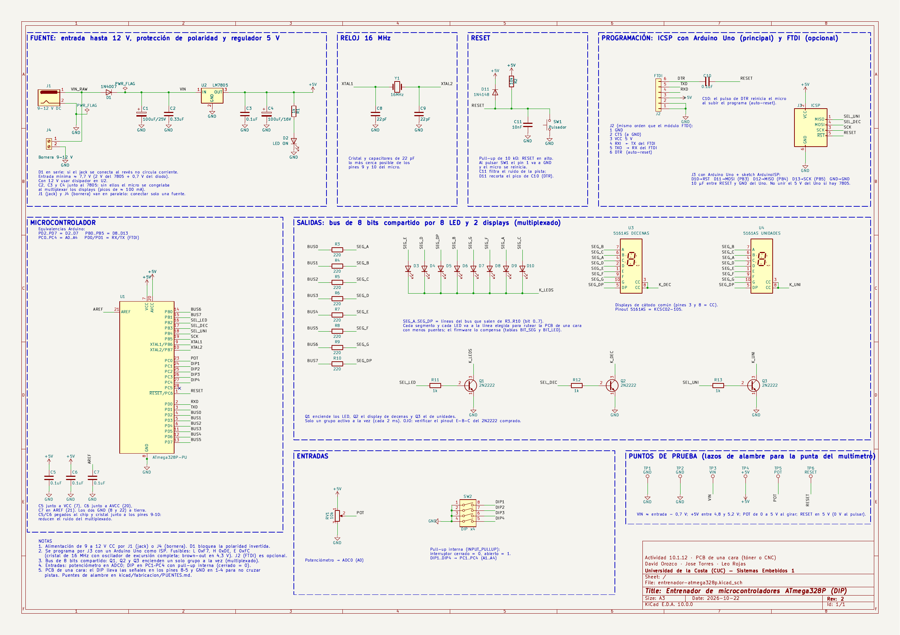
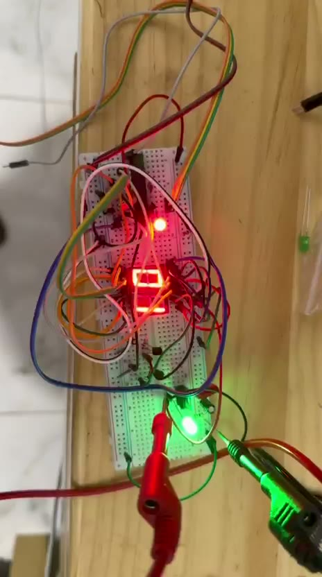
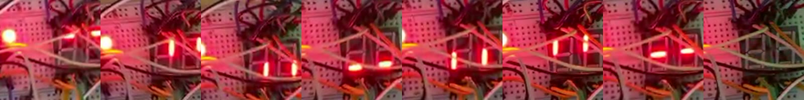
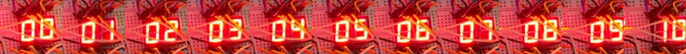
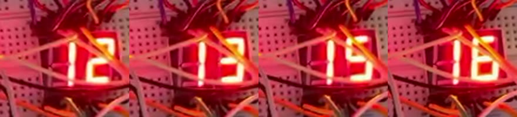
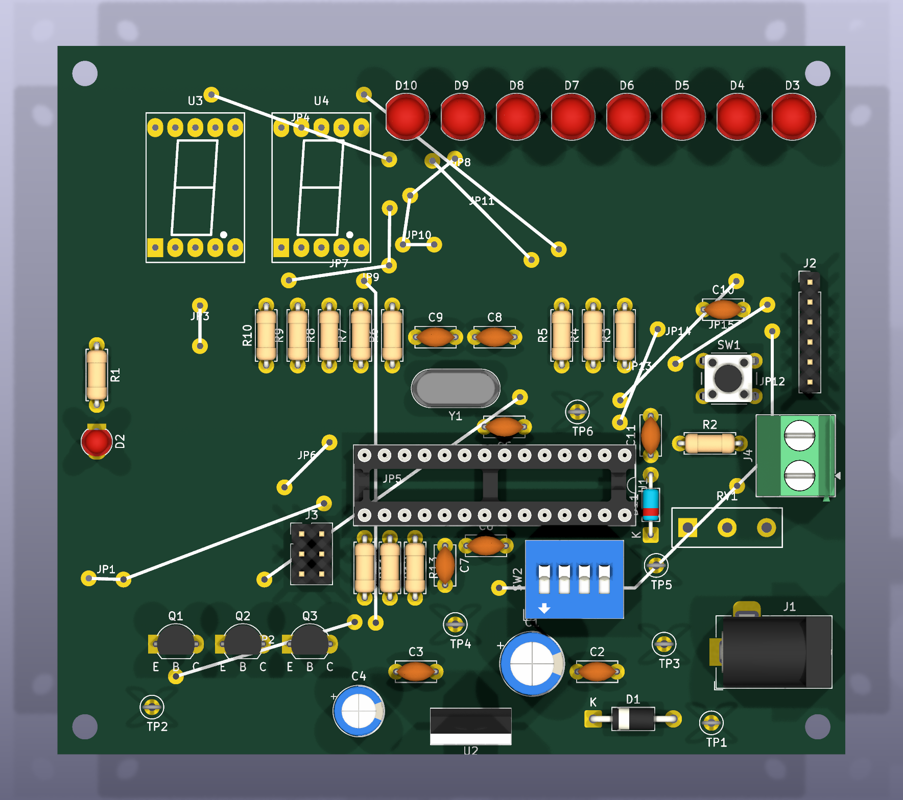
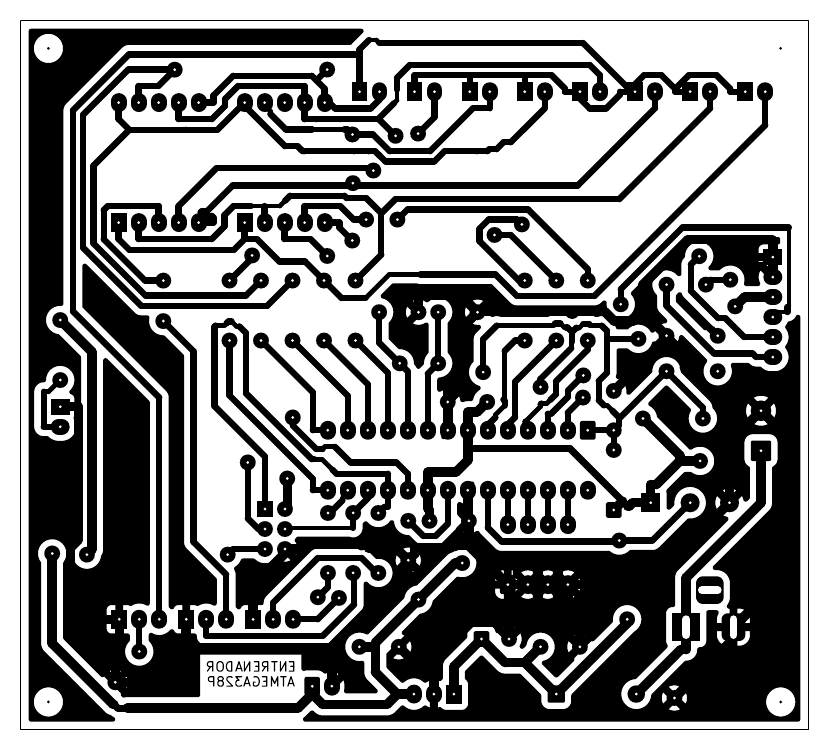

# Registro técnico — Entrenador ATmega328P

**Sistemas Embebidos 1 — Actividad 10.1.12** (sección *10.1. Microcontrolador ATmega328* del material)

> Registro de diseño, construcción y pruebas hasta el 22 de octubre de 2026. Los estados pendientes de este documento son históricos: el equipo confirmó el hardware funcional terminado el 23 de octubre. Consultar el [README](README.md) para el resumen actual.

## Estado del avance (22 de octubre de 2026)

| Parte | Estado |
|-------|--------|
| Diseño y asignación de pines | Terminado |
| Esquemático en KiCad (ERC sin errores) | Terminado — [`kicad/esquematico.pdf`](kicad/esquematico.pdf) |
| Lista de conexiones pin a pin | Terminado — [`kicad/CONEXIONES.md`](kicad/CONEXIONES.md) |
| ATMega328P en protoboard con cristal de 16 MHz y LM7805 | Funcionando |
| Programación con Arduino Uno como ISP (bootloader + fusibles) | Funcionando |
| 2 displays de 7 segmentos multiplexados con 2 transistores | Funcionando (ver problema 4) |
| 8 LED + Q1, potenciómetro, DIP switch | Pendiente de montar |
| Firmware completo del entrenador (`firmware/entrenador`) | Compila; falta probarlo en hardware |
| Simulación en SimulIDE | Pendiente |
| PCB propia de una cara (KiCad, toner o CNC) | Diseñada, revisada y verificada (DRC: 0 sin conectar, 0 diferencias con el esquemático) — [sección 12](#12-pcb-de-una-cara-toner-o-cnc). Falta fabricarla |

## 1. Requisitos del enunciado

| # | Requisito | Cómo se resuelve |
|---|-----------|------------------|
| 1 | Potenciómetro como entrada analógica | Pot 10 kΩ en `PC0 / ADC0 (A0)` |
| 2 | 8 LED como salidas digitales | Bus de 8 bits compartido con los displays |
| 3 | DIP switch de 4 posiciones | `PC1..PC4 (A1..A4)` con pull-up interna |
| 4 | 2 displays de 7 segmentos | Mismo bus (a..g + dp), multiplexados |
| 5 | Salidas compartidas (permitido) | 3 grupos (LEDs, decenas, unidades) seleccionados con 3 transistores NPN |
| 6 | Poder programar el micro | Conector ICSP (J3) + Arduino Uno como ISP. FTDI por J2 como opción |
| 7 | Pulsador de RESET | Pull-up 10 kΩ + pulsador a GND en el pin 1 |
| 8 | Regulador de hasta 12 V con protección de polaridad inversa | 1N4007 en serie + LM7805 |
| 9 | PCB universal (bonificación si es PCB propio) | **PCB propia** de una cara diseñada en KiCad (sección 12), lista para transferencia de tóner o fresado CNC |

## 2. Esquemático



- PDF: [`kicad/esquematico.pdf`](kicad/esquematico.pdf) (A3).
- Proyecto KiCad 10: [`kicad/entrenador-atmega328p.kicad_pro`](kicad/entrenador-atmega328p.kicad_pro).
- El esquemático se genera con [`kicad/tools/generar_esquematico.py`](kicad/tools/generar_esquematico.py) y se verifica con:
  - `kicad-cli sch erc` → **0 errores, 0 advertencias** ([`kicad/erc.rpt`](kicad/erc.rpt)).
  - [`kicad/tools/verificar_netlist.py`](kicad/tools/verificar_netlist.py) → compara el netlist exportado por KiCad con las conexiones esperadas: **155 pines, 43 redes, 0 errores**.
- Dentro de cada bloque (fuente, reloj, reset, programación) los componentes van unidos con cables en el orden en que pasa la señal; por ejemplo, la fuente se lee de izquierda a derecha: J1 → D1 → C1/C2 → 7805 → C3/C4 → LED de encendido. Entre bloques se usan etiquetas: las que tienen el mismo nombre (por ejemplo `SEG_A`, `BUS3`, `RESET`) están unidas. Los puntos de unión se calculan solos al generar el archivo.
- Las notas numeradas de la hoja resumen alimentación, programación (fusibles), multiplexado, entradas y el cableado del DIP para la PCB.
- Para montar en protoboard se usa [`kicad/CONEXIONES.md`](kicad/CONEXIONES.md): una tabla por red con cada pin que hay que unir.

Para regenerar el esquemático y sus verificaciones:

```bash
cd kicad
python3 tools/generar_esquematico.py
kicad-cli sch erc -o erc.rpt entrenador-atmega328p.kicad_sch
kicad-cli sch export netlist --format kicadsexpr -o out/net.net entrenador-atmega328p.kicad_sch
(cd tools && python3 verificar_netlist.py ../out/net.net)
kicad-cli sch export pdf -o esquematico.pdf entrenador-atmega328p.kicad_sch
pdftoppm -png -r 150 -singlefile esquematico.pdf esquematico
python3 tools/lista_conexiones.py out/net.net CONEXIONES.md
```

## 3. Asignación de pines

Se dejan libres `PD0/PD1` (RX/TX) para poder usar un FTDI, y `PB6/PB7` y `PC6` quedan para el cristal y el RESET.

| Función | Pin MCU | Pin físico | Pin Arduino |
|---------|---------|-----------:|-------------|
| Bus bit 0 (seg a / LED0) | PD2 | 4 | D2 |
| Bus bit 1 (seg b / LED1) | PD3 | 5 | D3 |
| Bus bit 2 (seg c / LED2) | PD4 | 6 | D4 |
| Bus bit 3 (seg d / LED3) | PD5 | 11 | D5 |
| Bus bit 4 (seg e / LED4) | PD6 | 12 | D6 |
| Bus bit 5 (seg f / LED5) | PD7 | 13 | D7 |
| Bus bit 6 (seg g / LED6) | PB0 | 14 | D8 |
| Bus bit 7 (seg dp / LED7) | PB1 | 15 | D9 |
| Selección LEDs (Q1) | PB2 | 16 | D10 |
| Selección display decenas (Q2) — también MOSI | PB3 | 17 | D11 |
| Selección display unidades (Q3) — también MISO | PB4 | 18 | D12 |
| SCK del ICSP (sin otro uso; pull-up en el firmware) | PB5 | 19 | D13 |
| Potenciómetro | PC0 / ADC0 | 23 | A0 |
| DIP SW1..SW4 | PC1..PC4 | 24..27 | A1..A4 |
| RX / TX (FTDI) | PD0 / PD1 | 2 / 3 | D0 / D1 |
| Cristal 16 MHz | PB6 / PB7 | 9 / 10 | — |
| RESET | PC6 | 1 | — |
| VCC / AVCC | — | 7 / 20 | — |
| GND | — | 8 / 22 | — |
| AREF (0.1 µF a GND) | — | 21 | — |

> **En la PCB** el orden de los segmentos y de los LED en el bus es otro: cada segmento y cada LED se conectó a la línea que dejaba rutear la placa de una cara con menos puentes. El firmware lo compensa con dos tablas (`BIT_SEG` y `BIT_LED` en [`entrenador.ino`](firmware/entrenador/entrenador.ino), `#define PCB 1`). En la protoboard se usa el orden de la tabla de arriba (`#define PCB 0`).
>
> | | a | b | c | d | e | f | g | dp |
> |---|---|---|---|---|---|---|---|---|
> | Bit del bus de cada segmento (PCB) | 1 | 2 | 0 | 3 | 4 | 5 | 6 | 7 |
>
> | | LED0 | LED1 | LED2 | LED3 | LED4 | LED5 | LED6 | LED7 |
> |---|---|---|---|---|---|---|---|---|
> | Bit del bus de cada LED (PCB) | 4 | 3 | 7 | 1 | 6 | 5 | 0 | 2 |

## 4. Multiplexado

```
 bus (8 pines) --[220 Ohm x8]--+--> 8 LED (anodos)          catodos -> Q1 (PB2)
                               +--> display DECENAS a..dp    catodo  -> Q2 (PB3)
                               +--> display UNIDADES a..dp   catodo  -> Q3 (PB4)
```

- El Timer2 interrumpe cada **2 ms** y enciende un solo grupo a la vez (LEDs → decenas → unidades): cada grupo se refresca a ~166 Hz y el ojo los ve encendidos al mismo tiempo.
- Displays de **cátodo común** (5161AS, mismo pinout que el símbolo KCSC02-105 de KiCad: pines 3 y 8 = cátodo). La huella de KiCad para ese símbolo es SMD, así que se hizo una propia de 10 pines THT ([`kicad/entrenador.pretty/Display_5161AS`](kicad/entrenador.pretty/Display_5161AS.kicad_mod)).
- Corriente por segmento ≈ (5 − 2 − 0.2) V / 220 Ω ≈ 13 mA → máximo ~100 mA por transistor (el 2N2222 soporta 600 mA).
- Las resistencias del bus se comparten porque solo un grupo está activo a la vez.

## 5. Fuente de alimentación

```
 J1 (hasta 12 V) --|>|--+------+------[ LM7805 ]------+------+------+--> +5V
                 1N4007 |      |      IN  GND  OUT    |      |      |
                      100uF  0.33uF        |        0.1uF  100uF   1k + LED
                        |      |           |          |      |      |
                 GND ---+------+-----------+----------+------+------+--> GND
```

- La entrada puede ser el jack **J1** o la bornera **J4** (en paralelo, las dos antes del diodo): usar solo una a la vez.
- El 1N4007 en serie bloquea la corriente si la fuente se conecta al revés.
- Usar un adaptador de **9 V**: con 12 V el 7805 disipa ~0,7 W (con un adaptador "12 V" sin regular puede pasar de 1 W); en ese caso ponerle un disipador pequeño.
- **RESET**: además de la pull-up de 10 kΩ lleva C11 (10 nF a GND, filtra el ruido de la pista) y D11 (1N4148 a +5V, recorta el pico que deja C10 al subir DTR).
- Entrada mínima ≈ 7.7 V (2 V de caída del 7805 + 0.7 V del diodo).
- **Los capacitores junto al 7805 son obligatorios** (ver problema 3).

## 6. Lista de materiales

| Cant. | Componente |
|------:|-----------|
| 2 | ATmega328P-PU (DIP-28) (uno de repuesto) + 2 zócalos DIP-28 |
| 1 | Cristal 16 MHz + 2 capacitores cerámicos 22 pF |
| 2 | Pulsadores 6x6 mm (RESET) |
| 1 | Potenciómetro 10 kΩ lineal |
| 1 | DIP switch de 4 posiciones |
| 8 | LED 5 mm |
| 2 | Display 7 segmentos cátodo común 0.56" (5161AS) |
| 3 | Transistor NPN 2N2222 (**comprobar el orden E-B-C con el multímetro antes de soldar**: algunos vienen C-B-E) |
| 8 / 4 / 2 | Resistencias 220 Ω / 1 kΩ / 10 kΩ |
| 6 / 1 | Capacitores cerámicos 0.1 µF (104) / 10 nF (103, filtro de RESET) |
| 1 | Capacitor cerámico 0.33 µF (334) |
| 1 / 1 | Electrolíticos 100 µF/25 V (entrada) y 100 µF/16 V (salida) |
| 1 / 2 / 1 | LM7805 (TO-220) / diodos 1N4007 / diodo 1N4148 (RESET) |
| 1 / 1 | Jack DC 5.5 x 2.1 mm + adaptador 9 V / 1 A, y bornera de 2 tornillos paso 5.08 mm (en paralelo con el jack) |
| 6 | Puntos de prueba: lazos de alambre rígido (o espadines) para la punta del multímetro |
| 1 | LED 3 mm (indicador de encendido) |
| 1 | Protoboard 830 puntos, cables jumper, PCB universal 7 x 9 cm, espadines |
| 1 | Arduino Uno R3 (programador ISP) + capacitor electrolítico 10 µF |
| 1 (opcional) | Módulo USB-serial FTDI FT232RL / CP2102 con pin DTR |

Para fabricar la PCB (sección 12):

| Cant. | Material |
|------:|-----------|
| 1 | Baquelita (o fibra de vidrio) de **una cara**, 10 x 10 cm (la placa mide 100 x 90 mm) |
| 1 | Impresión láser en papel couché / fotográfico brillante / papel de transferencia (no inyección de tinta) |
| — | Plancha, lija fina o esponja de brillo, alcohol isopropílico |
| — | Cloruro férrico o persulfato de sodio, recipiente plástico, guantes |
| — | Brocas 0.8 mm (casi todo), 0.9–1.1 mm (diodos, 7805, pulsador, zócalo, espadines, puntos de prueba), 1.3 mm (bornera y potenciómetro), 3.0 mm (jack) y 3.2 mm para los 4 agujeros de montaje |
| ~50 cm | Alambre aislado (cable UTP, 0.5 mm) para los 15 puentes |
| 1 | Zócalo DIP-28 (ya en la lista) y espadines macho (J2 FTDI 1x6, J3 ICSP 2x3) |

## 7. Programación: Arduino Uno como ISP

Procedimiento usado y probado (con `arduino-cli`; en el IDE de Arduino los pasos equivalentes están entre paréntesis).

**Conexiones** (J3 en el esquemático):

| Arduino Uno | ATMega328P (pin) |
|-------------|------------------|
| D10 | 1 (RESET) |
| D11 | 17 (MOSI / PB3) |
| D12 | 18 (MISO / PB4) |
| D13 | 19 (SCK / PB5) |
| GND | 8 / 22 (GND) |
| 5V | 7 / 20 — **solo si el 7805 no está alimentando la protoboard** |

**Pasos:**

1. Cargar el sketch [`firmware/ArduinoISP`](firmware/ArduinoISP/ArduinoISP.ino) (ejemplo oficial de Arduino) en el Uno:
   ```
   arduino-cli upload -b arduino:avr:uno -p <puerto-del-uno> firmware/ArduinoISP
   ```
2. Poner un **capacitor de 10 µF entre RESET y GND del Uno** (negativo a GND). Evita que el Uno se reinicie al programar el otro chip.
3. Verificar la comunicación leyendo la firma del chip (solo lectura):
   ```
   avrdude -c stk500v1 -b 19200 -P <puerto-del-uno> -p m328p
   ```
   Respuesta esperada: `Device signature = 1E 95 0F (ATmega328P)`.
4. Quemar el bootloader (*Herramientas > Quemar bootloader*). Esto configura los fusibles para el cristal externo de 16 MHz:
   ```
   arduino-cli burn-bootloader -b arduino:avr:uno -P arduinoasisp -p <puerto-del-uno>
   ```
5. Subir programas (*Programa > Subir usando programador*):
   ```
   arduino-cli upload -b arduino:avr:uno -P arduinoasisp -p <puerto-del-uno> firmware/<sketch>
   ```
6. **Ajustar los fusibles recomendados** (después de quemar el bootloader, porque este vuelve a escribir los de Arduino):
   ```
   avrdude -c stk500v1 -b 19200 -P <puerto-del-uno> -p m328p -U lfuse:w:0xF7:m -U efuse:w:0xFC:m
   ```
   - `lfuse 0xF7`: oscilador de cristal de excursión completa (*full swing*). El `0xFF` de Arduino es el modo de bajo consumo, que la hoja de datos advierte que es más sensible al ruido.
   - `efuse 0xFC`: *brown-out* en 4,3 V. Con `0xFD` (2,7 V) el chip sigue corriendo entre 2,7 y 3,8 V, donde 16 MHz está fuera de especificación, y puede ejecutar código corrupto sin reiniciarse.

**Fusibles leídos y escritos en nuestro chip:**

| Fusible | De fábrica (leído) | Después de quemar el bootloader | Recomendado (paso 6) | Significado |
|---------|:------------------:|:-------------------------------:|:--------------------:|-------------|
| lfuse | `0x62` | `0xFF` | **`0xF7`** | Reloj: oscilador interno 8 MHz ÷ 8 = 1 MHz → cristal externo 16 MHz (`0xF7` = *full swing*) |
| hfuse | `0xD9` | `0xDE` | `0xDE` | Habilita el arranque desde el bootloader (Optiboot, 512 bytes) |
| efuse | `0xFF` | `0xFD` | **`0xFC`** | Detector de bajo voltaje (*brown-out*): 2,7 V → **4,3 V** |
| lock | `0xFF` | `0x0F` | `0x0F` | Protege la sección del bootloader |

> Si el chip nuevo no se pasa al cristal (sin quemar el bootloader), corre a 1 MHz y todos los tiempos quedan 16 veces más lentos.

## 8. Pruebas realizadas

| # | Prueba | Firmware | Resultado |
|---|--------|----------|-----------|
| 1 | Lectura de la firma por ISP | — | Primer intento `00 00 00` (el chip no respondía). Tras revisar el cableado: `1E 95 0F` |
| 2 | Quemar bootloader y fusibles | — | Fusibles escritos y verificados; Optiboot (502 bytes) verificado. El chip siguió respondiendo con el cristal → **el cristal oscila** |
| 3 | Parpadeo de PB5 (pin 19) a 1 Hz | [`prueba-blink`](firmware/prueba-blink/prueba-blink.ino) | Funciona con el Uno y luego **solo con el LM7805** |
| 4 | Displays en estático (todos los segmentos y transistores encendidos) | [`prueba-estatica`](firmware/prueba-estatica/prueba-estatica.ino) | Permitió encontrar y corregir errores de cableado midiendo con multímetro |
| 5 | Segmento por segmento + contador 00–99 multiplexado | [`prueba-displays`](firmware/prueba-displays/prueba-displays.ino) | Funciona; ver problemas 3 y 4 |

**Montaje en protoboard** (los displays quedaron girados 90°):



**Prueba segmento por segmento** (a, b, c, d, e, f, g, dp; ambos displays a la vez):



**Contador multiplexado, 00 a 10** (imágenes rotadas para leer los dígitos):



## 9. Problemas encontrados y soluciones

1. **El chip no respondía por ISP (firma `00 00 00`).** El Uno sí respondía (`AVR device initialized`), pero la línea MISO quedaba en bajo. Causas típicas: chip sin alimentación, chip invertido o un cable de ISP corrido una fila. Se corrigió el cableado y respondió `1E 95 0F`.
2. **Al quitar el GND del Uno "dejaba de parpadear".** El LED que se estaba mirando era el LED "L" del Uno, que repite el pin 19 solo mientras el cable D13 y el GND común están conectados. Con un LED propio en el pin 19 se comprobó que el chip funciona solo con el 7805.
3. **Con el LM7805 el contador se congelaba al llegar a 03–04.** Con la alimentación del Uno funcionaba. Durante la animación se enciende un segmento a la vez, pero el contador enciende 6–7 segmentos y conmuta cada 2 ms (picos de ~100 mA). Sin capacitores, el 5 V del 7805 tenía caídas que bloqueaban el micro. **Solución:** capacitores en la entrada y salida del 7805 y un electrolítico en la salida. Después de esto ya no se congeló.
4. **El contador se salta números (pendiente).** En un video de 30 s se analizaron los cuadros uno por uno: faltan 14, 24, 45, 46, 48, 49, 53, 62, 65, 74, 88, 96, 98, 99 y 00, y el 03 se vio solo ~33 ms en lugar de 300 ms. De 00 a 97 tardó ~24.6 s en lugar de 29.1 s, o sea que **el tiempo también se adelanta**: no es un error del programa ni de los dígitos (todos se dibujan bien). El micro pierde la cuenta del tiempo por ruido eléctrico en la alimentación o en el cristal, sin llegar a reiniciarse.

   

   Acciones en curso:
   - Repetir el video alimentando desde el 5 V del Uno (prueba A/B) para confirmar que es la fuente.
   - Capacitores de 0.1 µF pegados al chip entre los pines 7–8 y 20–22.
   - Cristal y capacitores de 22 pF lo más cerca posible de los pines 9–10, sin cables largos encima.
   - Fusibles `lfuse 0xF7` (*full swing*) y `efuse 0xFC` (*brown-out* en 4,3 V): ver sección 7, paso 6.
   - Revisión de diseño (22 oct): es posible que parte del salto sea **del video y no de la placa**. El tiempo que falta (4,5 s) coincide casi exactamente con la duración de los números que faltan (12 × 0,3 s + el 03 corto ≈ 3,9 s), y un micro con cristal no puede correr un 15 % más rápido. Los videos de celular tienen cuadros por segundo variables y pierden cuadros. Para confirmarlo: leer las marcas de tiempo reales del video (`ffprobe -show_frames`, campo `pts_time`) o grabar un cronómetro junto al display.
   - En la PCB ya se aplicaron las demás medidas: C5 y C6 pegados a los pines 7–8 y 20–22, cristal junto a los pines 9–10, GND y cristal siempre en cobre (nunca por un puente) y filtro en RESET (C11 + D11).

## 10. Firmware

| Sketch | Para qué | Estado |
|--------|----------|--------|
| [`ArduinoISP`](firmware/ArduinoISP/ArduinoISP.ino) | Se carga en el Arduino Uno para usarlo como programador | Probado |
| [`prueba-blink`](firmware/prueba-blink/prueba-blink.ino) | Parpadeo del pin 19: comprueba chip y cristal | Probado |
| [`prueba-estatica`](firmware/prueba-estatica/prueba-estatica.ino) | Todo encendido sin multiplexar, para medir con multímetro | Probado |
| [`prueba-displays`](firmware/prueba-displays/prueba-displays.ino) | Segmento por segmento + contador 00–99 multiplexado | Probado |
| [`entrenador`](firmware/entrenador/entrenador.ino) | Firmware final: 4 modos con el DIP switch | Compila; falta montar LEDs, pot y DIP |

Modos del firmware final (SW2 SW1):

| SW2 SW1 | Modo | LEDs | Displays |
|:-------:|------|------|----------|
| 0 0 | Lectura ADC | Barra proporcional al pot | Pot escalado 00..99 |
| 0 1 | Contador | Cuenta en binario | Cuenta 00..99, velocidad con el pot |
| 1 0 | Lectura del DIP | Estado de SW1..SW4 | Valor del DIP (00..15) |
| 1 1 | Secuencia | "Auto fantástico", velocidad con el pot | Posición del LED |

Escritura del bus (bits 0–5 en PORTD, bits 6–7 en PORTB):

```c
PORTD = (PORTD & 0x03) | (valor << 2);   // PD2..PD7
PORTB = (PORTB & 0xFC) | (valor >> 6);   // PB0..PB1
```

## 11. Simulación

Simulador elegido: **SimulIDE** (libre, Linux/Windows, está en la lista del material 10.1.3). Permite usar el ATmega328 suelto (no la placa Arduino) con cristal, transistores, displays, DIP switch y potenciómetro, y cargarle el `.hex` compilado.

| Simulador | ATMega328P suelto | Transistores, 7 seg, DIP, pot | Uso |
|-----------|:-----------------:|:-----------------------------:|-----|
| SimulIDE | Sí | Sí | Principal |
| Proteus | Sí | Sí | Alternativa (licenciado, Windows) |
| Wokwi | No (solo placas Arduino) | No simula transistores | Solo para probar el firmware |

Pendiente: armar el circuito en SimulIDE y cargar `firmware/entrenador` (`arduino-cli compile --output-dir` genera el `.hex`).

## 12. PCB de una cara (tóner o CNC)



Placa de **100 x 90 mm, cobre solo abajo** (B.Cu), pensada para hacerla en casa:

| Parámetro | Valor |
|-----------|-------|
| Pistas | 0.8 mm señal, 1.2 mm alimentación (+5V, GND, VIN) |
| Separación mínima | 0.45 mm (casi todo a 0.5 mm) |
| Pads | 2.0 mm (ovalados 2.4 x 2.0 en el ATmega, displays, LEDs y espadines) |
| Relleno de GND | En toda la cara libre: menos cobre que disolver y mejor tierra para el multiplexado |
| Puentes de alambre | **15 puentes (20 alambres)** del lado de componentes, marcados `JP1..JP15` en la serigrafía. **Ningún agujero de puente queda debajo de una pieza** |
| Lo que nunca va por un puente | GND (relleno continuo), VIN, la entrada y el cristal. C5 y C6 van pegados a los pines 7–8 y 20–22 |
| Entrada de alimentación | Jack J1 o bornera J4 (borde derecho, la entrada del cable hacia afuera) |
| Puntos de prueba | TP1 y TP2 GND, TP3 VIN, TP4 +5V, TP5 POT, TP6 RESET (lazos de alambre para la punta del multímetro) |
| Transistores | Marcados `E B C` en la serigrafía |
| Verificación | DRC de KiCad: **0 conexiones sin hacer**, 0 errores de cobre, 0 diferencias con el esquemático. Quedan 3 avisos aceptados: el patio del agujero H2 toca el LED D3 (usar tornillo de nailon) y 2 alivios térmicos con un solo rayo (señales de poca corriente) |

Cobre tal como se imprime (el texto `ENTRENADOR ATMEGA328P` sale **al revés** en el papel; una vez transferido se lee bien):



### Archivos ([`kicad/fabricacion/`](kicad/fabricacion))

| Archivo | Para qué |
|---------|----------|
| [`toner/1-cobre-B_Cu-1a1.pdf`](kicad/fabricacion/toner/1-cobre-B_Cu-1a1.pdf) | **Imprimir a escala 100 %** (sin "ajustar a página") en láser. Es el cobre |
| [`toner/2-serigrafia-F_SilkS-espejo-1a1.pdf`](kicad/fabricacion/toner/2-serigrafia-F_SilkS-espejo-1a1.pdf) | Opcional: serigrafía para transferir del lado de componentes (ya va en espejo) |
| [`guia-montaje.pdf`](kicad/fabricacion/guia-montaje.pdf) | Dónde va cada componente y cada puente (vista desde arriba) |
| [`vista-cobre-desde-abajo.pdf`](kicad/fabricacion/vista-cobre-desde-abajo.pdf) | El cobre como se ve al soldar, para revisar pistas |
| [`PUENTES.md`](kicad/fabricacion/PUENTES.md) | Lista de los 15 puentes: red, largo, piezas bajo las que pasa y agujeros |
| [`cnc/`](kicad/fabricacion/cnc) | Gerber (`B_Cu`, `Edge_Cuts`, `F_Silkscreen`, `B_Mask`) + taladros Excellon (`PTH.drl`, `NPTH.drl`), origen en la esquina de la placa |

### Opción A: transferencia de tóner

1. Imprimir `1-cobre-B_Cu-1a1.pdf` al **100 %** y medir con regla: el borde debe medir 100 x 90 mm. **No** imprimir en espejo: el cobre está abajo, así que el PDF ya sale como debe ir pegado.
2. Cortar la baquelita a 100 x 90 mm, lijar suave y limpiar con alcohol (sin tocar con los dedos).
3. Poner el papel boca abajo sobre el cobre y planchar 3–5 min (máxima temperatura, sin vapor), presionando bien bordes y esquinas.
4. Dejar enfriar, remojar en agua y retirar el papel frotando con el dedo. Retocar con marcador permanente los cortes.
5. Atacar con cloruro férrico (10–20 min moviendo el recipiente). Quitar el tóner con lija fina o acetona.
6. Perforar: los puntos blancos en el centro de cada pad marcan el agujero. 0.8 mm casi todo, 1.0 mm en espadines/7805/1N4007/jack, 1.3 mm en el potenciómetro.

### Opción B: fresado CNC

1. Abrir en **FlatCAM** (o similar) `entrenador-atmega328p-B_Cu.gbr`, `-PTH.drl`, `-NPTH.drl` y `-Edge_Cuts.gbr` desde [`cnc/`](kicad/fabricacion/cnc).
2. Como el cobre es la cara de abajo, **espejar en X** (cara "bottom") el cobre, los taladros y el contorno con el mismo eje.
3. Aislamiento con fresa en V 20–30° (0.2 mm), 2–3 pasadas; taladrado con las brocas de arriba; contorno con fresa de 1–2 mm (o cortar a mano).
4. Enviar el G-code con Candle / bCNC / UGS.

### Montaje

1. **Primero los puentes** de alambre ([`PUENTES.md`](kicad/fabricacion/PUENTES.md)). Ningún agujero queda bajo una pieza, pero algunos alambres pasan por debajo del zócalo, de un display, de J4 o del potenciómetro: van pegados a la placa y antes que esas piezas. Los de `+5V` (JP1 y JP12) con alambre rígido de 0.5 mm o más.
2. Luego, de más bajo a más alto: resistencias, 1N4007 y 1N4148, zócalo DIP-28, capacitores cerámicos, cristal, LEDs, puntos de prueba, transistores, DIP switch, pulsador, espadines, displays, electrolíticos, 7805, jack, bornera y potenciómetro.
3. **Transistores**: antes de soldarlos, comprobar con el multímetro (prueba de diodo o zócalo hFE) que el orden es E-B-C como dice la serigrafía. Algunos "2N2222" en TO-92 vienen C-B-E: en ese caso se giran 180°. Si quedan al revés no se dañan, pero ese grupo se ve muy tenue o apagado.
4. Antes de poner el ATmega, con 9 V en J1 o J4, medir en los puntos de prueba (negra en TP1 o TP2): TP3 (VIN) ≈ entrada − 0.7 V, TP4 (+5V) entre 4.8 y 5.2 V, TP6 (RESET) ≈ 5 V y 0 V al pulsar SW1, TP5 (POT) de 0 a 5 V al girar.
5. Programar por J3 (ICSP) con el Arduino Uno como en la sección 7 y ajustar los fusibles recomendados (paso 6). Cargar `firmware/entrenador` con `#define PCB 1`.

> Cambio respecto al protoboard: en el DIP switch las señales van por los pines **8..5** (DIP1..DIP4) y GND por los pines 1..4. Eléctricamente es lo mismo (el interruptor no tiene polaridad), pero así las 4 pistas llegan al micro sin cruzarse. Los números 1–4 impresos en el DIP siguen siendo DIP1..DIP4.

### Cómo se generó (reproducible)

- [`kicad/tools/generar_pcb.py`](kicad/tools/generar_pcb.py) toma el netlist del esquemático, coloca los componentes, agranda los pads y aplica el ruteo de [`ruteo-freerouting.ses`](kicad/ruteo-freerouting.ses) (Freerouting 2.5 con la cara de arriba como "capa de puentes" cara). Cada tramo de arriba se convierte en un puente `JPn` (recto si así pasa bajo menos piezas), se agrega el texto en cobre y el relleno de GND.
- Reglas del ruteo: zonas prohibidas para los agujeros de puente sobre cada pieza (`KEEPOUT=huecos`), y GND, VIN, la entrada y el cristal solo en cobre. El orden de segmentos y LED en el bus (`SEG_PERM` / `LED_PERM`) se eligió probando ~100 combinaciones de orden y costos: la elegida es la de menos puentes que conecta todo sin agujeros bajo las piezas.
- [`kicad/tools/exportar_fabricacion.sh`](kicad/tools/exportar_fabricacion.sh) exporta los PDF, Gerber, taladros, vistas 3D y el DRC.

```bash
cd kicad
kicad-cli sch export netlist -o out/net.net entrenador-atmega328p.kicad_sch
python3 tools/generar_pcb.py importar      # 'rutear' para rutear de nuevo (necesita java + freerouting.jar)
./tools/exportar_fabricacion.sh
python3 tools/lista_puentes.py
```

## 13. Pendientes

1. Confirmar si los saltos del contador son de la placa o del video (problema 4) y ajustar los fusibles recomendados.
2. Montar los 8 LED con Q1, el potenciómetro y el DIP switch, y probar `firmware/entrenador`.
3. Simulación en SimulIDE con capturas.
4. Fabricar la PCB (tóner o CNC), montarla y probarla con `firmware/entrenador`.
5. Informe final paso a paso y exposición.

## Estructura de la carpeta

```
C2-ATMEGA-328/
+-- README.md                 (este documento)
+-- README.pdf                (este documento en PDF)
+-- capturas/                 (fotos y cuadros del video de prueba)
+-- firmware/
|   +-- ArduinoISP/           (programador, se carga en el Uno)
|   +-- prueba-blink/
|   +-- prueba-estatica/
|   +-- prueba-displays/
|   +-- entrenador/           (firmware final)
+-- kicad/
    +-- entrenador-atmega328p.kicad_pro / .kicad_sch
    +-- esquematico.pdf / esquematico.png
    +-- erc.rpt               (verificación eléctrica: 0 errores, 0 advertencias)
    +-- CONEXIONES.md         (lista de conexiones pin a pin)
    +-- entrenador-atmega328p.kicad_pcb   (PCB de una cara)
    +-- entrenador.pretty/    (huellas propias: display 5161AS, potenciómetro, puente)
    +-- fp-lib-table          (biblioteca de huellas propias)
    +-- ruteo-freerouting.ses (ruteo elegido)
    +-- fabricacion/          (PDF para tóner, Gerber/taladros para CNC, puentes, vistas 3D)
    +-- tools/                (generadores del esquemático y la PCB, verificación)
```
